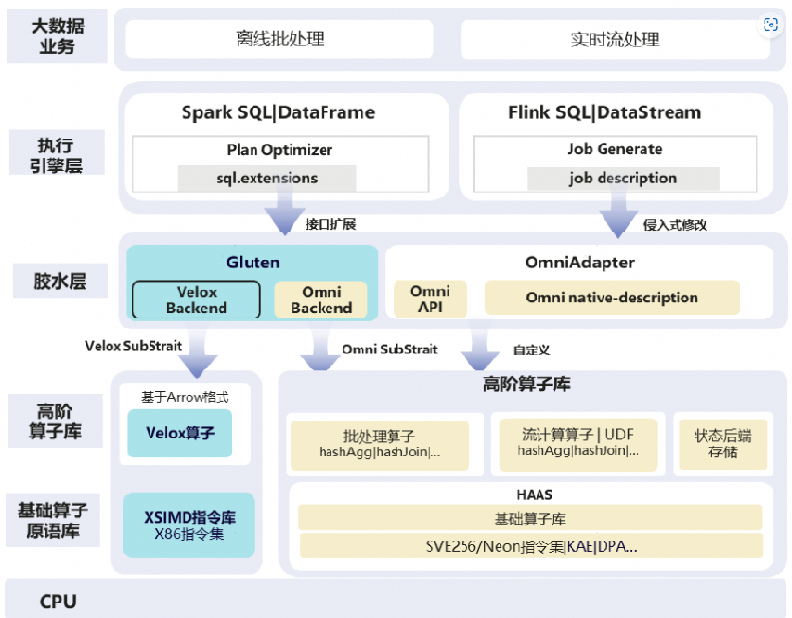

# 最新消息

-   \[2025.12.30\]：发布OmniOperator 2.0.0，新增适配Spark的适配层Gluten 1.3版本，SparkExtension新增支持concat_ws、regexp、regexp_replace、trim和floor表达式；更新OmniAdvisor 2.0.0；发布OmniStream 1.1.0，新增支持task级别算子回退机制，KeyedCoProcess算子支持checkpoint、restore；发布OmniStateStore 1.1.0，支持对接Flink Metric框架并实现部分常用的Metric指标，支持Priority Queue持久化存储，支持KV分离存储。
-   \[2024.09.30\]：OmniRuntime特性发布OmniAdvisor参数调优2.0特性。
-   \[2024.06.30\]：Spark 3.3.1新增对Parquet格式列式写入的支持；新增支持操作系统CentOS 7.9；新增OmniStream Flink Native化，该特性通过使用Native Code（C/C++）实现开源软件对应算子，从而加速Flink引擎的执行，提升查询性能；新增OmniStateStore状态存储，该特性针对大状态IO性能较差的问题，实现了一种新型的状态存储方式，提升了Flink的IO性能。
-   \[2024.03.30\]：OmniOperator算子加速适配Spark 3.4.3、Spark 3.5.2；OmniMV物化视图适配Spark 3.4.3；新增OmniScheduler Yarn负载调度算法特性，在Hadoop集群节点间负载不均衡场景下，利用Yarn负载调度算法实现集群资源的均衡配置和高效利用。

# 项目介绍

## 概述

大数据OmniRuntime通过插件化的形式，端到端提升数据加载、数据计算和数据交换的性能，从而提升大数据分析性能。

随着互联网的发展，数据规模出现了爆炸式的增长，需要处理的数据量越来越大，CPU算力的增长远远滞后于数据的增长。大数据开源生态也越来越丰富，但多样化的计算引擎和开源组件也同时带来了全生命周期数据处理性能提升难的问题。不同的大数据引擎采用各自独特的优化策略和技术来提高性能和效率，但有些优化项会在多个引擎中重复应用，可能存在差异或冲突，导致计算性能下降。此外，重复应用相同的优化项可能导致资源竞争和冲突，降低整体计算性能。

大数据OmniRuntime是鲲鹏BoostKit大数据面向应用加速推出的一系列特性，通过插件化的形式，端到端提升数据加载、数据计算和数据交换的性能，从而提升大数据分析的性能。

OmniRuntime包括的子特性和已适配的开源组件及版本如[表1](#表1)所示。

**表 1 OmniRuntime子特性介绍和已适配的开源组件及版本**

| 特性名称                    | 特性介绍                  | 开源组件及版本                                                                                                                       |
|-------------------------|-----------------------|-------------------------------------------------------------------------------------------------------------------------------|
| OmniOperator算子加速        | 采用Native Code（C/C++）实现大数据SQL算子来提高查询性能的特性，通过列式存储和向量化执行技术，同时利用鲲鹏向量化指令，用高性能Native算子替换开源版本Java算子，提升算子的执行效率，从而提升查询引擎的查询性能。 | - Spark 3.1.1  - Spark 3.3.1  - Spark 3.4.3  - Spark 3.5.2  - Hive 3.1.0  - openLooKeng 1.6.1  - Gluten 1.3 |
| OmniMV物化视图              | 通过AI算法从历史SQL查询中推荐出最优物化视图，并在Spark中自动对用户SQL进行物化视图匹配，将匹配成功的物化视图替换用户执行计划的部分SQL，减少重复计算，提升查询性能。该特性支持用户将SQL任务提交给Spark集群，集群管理节点进行任务分配，分发多个子任务到对应的多个计算节点执行。 | - Spark 3.1.1  - Spark 3.3.1  - Hive 3.1.0  - ClickHouse 22.3.6.5                                                    |
| OmniScheduler Yarn负载调度算法 | 优化了Hadoop Yarn的容量调度算法，通过获取集群的负载信息，并基于节点物理资源权重计算及排序结果，优先调度低负载节点，提升了集群的负载均衡性，实现资源的均衡配置和高效利用。   | - Spark 3.1.1  - Spark 3.3.1  - Hive 3.1.0  - Hadoop 3.3.4                                                           |
| OmniShield机密大数据 | 该特性是一个大数据引擎Spark的机密计算组件，运行在客户数据中心的TEE环境内，通过在基于硬件的TEE环境中执行计算过程对数据进行加解密，保证数据在REE侧也是安全和隐私的。在机密计算场景下，OmniRuntime的OmniShield机密大数据特性提供了DataFrame、SparkSQL应用的数据源加解密能力，并可以结合Arm的机密计算TEE套件能力为Spark应用提供端到端安全防护。  | - Spark 3.3.1  - Hive 3.1.0                                                                                                |
| OmniStream Flink Native化     | 是一种采用Native Code（C/C++）实现Flink SQL算子来提高查询性能的特性，通过对Flink引擎进行Native化改造，以实现性能的显著提升。                | Flink 1.16.3                                                                                                                  |
| OmniStateStore状态优化 | 基于Flink提供的状态优化后端插件机制，提供状态优化的加速，从而提升Flink的整体性能。    | - Flink 1.16.1  - Flink 1.16.3  - Flink 1.17.1                                                                          |

## 架构图

OmniRuntime架构图如下:

下面给出架构图的一些介绍，可以从社区主页直接获取一部分内容。

## 社区主页

[鲲鹏社区OmniRuntime主页](https://www.hikunpeng.com/boostkit/big-data#base-soft)

# 特性介绍

**表 2 特性介绍**

<table><thead align="left"><tr id="row23424320348"><th class="cellrowborder" valign="top" width="12.861286128612862%" id="mcps1.2.4.1.1">
特性大类

</th>
<th class="cellrowborder" valign="top" width="16.89168916891689%" id="mcps1.2.4.1.2">
特性名称

</th>
<th class="cellrowborder" valign="top" width="70.24702470247026%" id="mcps1.2.4.1.3">
特性介绍

</th>
</tr>
</thead>
<tbody><tr id="row8343133223416"><td class="cellrowborder" rowspan="3" valign="top" width="12.861286128612862%" headers="mcps1.2.4.1.1 ">
<strong id="b1589315383368">离线批处理特性</strong>

</td>
<td class="cellrowborder" valign="top" width="16.89168916891689%" headers="mcps1.2.4.1.2 ">
<a href="https://gitcode.com/openeuler/OmniOperator" target="_blank" rel="noopener noreferrer">Omnioperator</a>算子加速

</td>
<td class="cellrowborder" valign="top" width="70.24702470247026%" headers="mcps1.2.4.1.3 ">
采用C++结合向量化指令实现批处理算子，以列式内存数据格式OmniVec进行内存计算，充分利用向量化指令加速，提升SQL计算性能。

</td>
</tr>
<tr id="row1834363210344"><td class="cellrowborder" valign="top" headers="mcps1.2.4.1.1 ">
<a href="https://gitcode.com/openeuler/Gluten" target="_blank" rel="noopener noreferrer">Gluten</a>

</td>
<td class="cellrowborder" valign="top" headers="mcps1.2.4.1.2 ">
基于Gluten为 Spark 引擎引入高性能的 Native Backend 支持。

</td>
</tr>
<tr id="row4343232173416"><td class="cellrowborder" valign="top" headers="mcps1.2.4.1.1 ">
<a href="https://gitcode.com/openeuler/OmniAdaptor" target="_blank" rel="noopener noreferrer">OmniAdaptor</a>

</td>
<td class="cellrowborder" valign="top" headers="mcps1.2.4.1.2 ">
Spark 与 OmniOperator、Flink与OmniStream之间的桥梁组件，作为胶水层承接两者的运行时协作。

</td>
</tr>
<tr id="row834363210349"><td class="cellrowborder" rowspan="2" valign="top" width="12.861286128612862%" headers="mcps1.2.4.1.1 ">
<strong id="b9434185012367">实时流处理在线加速特性</strong>

</td>
<td class="cellrowborder" valign="top" width="16.89168916891689%" headers="mcps1.2.4.1.2 ">
<a href="https://gitcode.com/openeuler/OmniStream" target="_blank" rel="noopener noreferrer">OmniStream</a> Native化

</td>
<td class="cellrowborder" valign="top" width="70.24702470247026%" headers="mcps1.2.4.1.3 ">
采用C++结合向量化指令实现流式算子，以列式内存数据格式OmniVec进行内存计算，充分利用向量化指令加速，提升SQL计算性能。

</td>
</tr>
<tr id="row4343163212348"><td class="cellrowborder" valign="top" headers="mcps1.2.4.1.1 ">
<a href="https://gitcode.com/openeuler/OmniStateStore" target="_blank" rel="noopener noreferrer">OmniStateStore</a>  状态优化

</td>
<td class="cellrowborder" valign="top" headers="mcps1.2.4.1.2 ">
互联网搜推大数据场景会产生的超大状态十几~几十TB的数据，Flink原生的后端状态存储采用RocksDB，在处理超大状态时有读写性能较差和CPU占用较高等瓶颈点，进而影响到Flink的作业处理时长。BoostStateStore作为高性能的状态存储加速组件，使用内存和NvmeSSD磁盘来构建状态存储访问加速层，并且通过优化LSM-Tree的compaction流程来降低CPU抖动对Flink作业执行的影响。

</td>
</tr>
</tbody>
</table>

# 关于社区

提供社区治理架构、SIG组织运作章程、参与贡献、邮件订阅、社媒联系方式等公共模块内容简介和指引。

# 贡献、建议与交流

欢迎大家为社区做贡献，如果使用过程中有任何问题/建议，或者需要反馈特性需求和bug报告，可以提交[Issues](https://gitcode.com/boostkit/community/blob/master/docs/contributor/issue-submit.md)联系我们，具体贡献方法可参考[这里](https://gitcode.com/boostkit/community/blob/master/docs/contributor/contributing.md)。同时也欢迎大家在[讨论专区](https://gitcode.com/boostkit/community/discussions)展开讨论交流。感谢您的支持。

# LICENSE

本项目采用Apache License 2.0许可证。详见[LICENSE](LICENSE)文件。

本项目的文档适用CC-BY 4.0许可证，具体请参见[LICENSE](LICENSE)文件。

