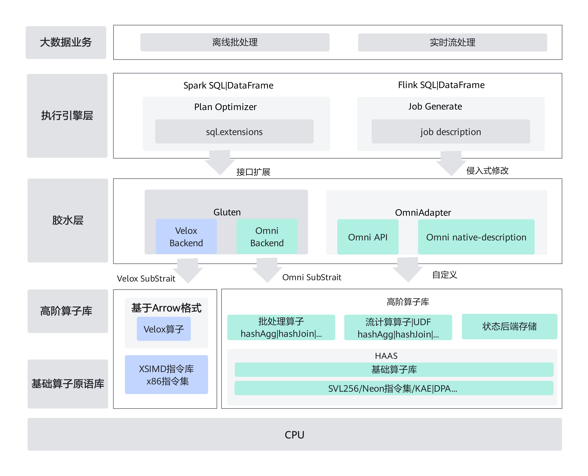

# 最新消息

- \[2025-12-30\]：发布OmniOperator 2.0.0，新增适配Spark的适配层Gluten 1.3版本，SparkExtension新增支持concat_ws、regexp、regexp_replace、trim和floor表达式；更新OmniAdvisor 2.0.0；发布OmniStream 1.1.0，新增支持task级别算子回退机制，KeyedCoProcess算子支持checkpoint、restore；发布OmniStateStore 1.1.0，支持对接Flink Metric框架并实现部分常用的Metric指标，支持Priority Queue持久化存储，支持KV分离存储。
- \[2024-09-30\]：OmniRuntime特性发布OmniAdvisor参数调优2.0特性。
- \[2024-06-30\]：Spark 3.3.1新增对Parquet格式列式写入的支持；新增支持操作系统CentOS 7.9；新增OmniStream Flink Native化，该特性通过使用Native Code（C/C++）实现开源软件对应算子，从而加速Flink引擎的执行，提升查询性能；新增OmniStateStore状态存储，该特性针对大状态IO性能较差的问题，实现了一种新型的状态存储方式，提升了Flink的IO性能。
- \[2024-03-30\]：OmniOperator算子加速适配Spark 3.4.3、Spark 3.5.2；OmniMV物化视图适配Spark 3.4.3；新增OmniScheduler Yarn负载调度算法特性，在Hadoop集群节点间负载不均衡场景下，利用Yarn负载调度算法实现集群资源的均衡配置和高效利用。

# 项目介绍

## 概述

大数据OmniRuntime通过插件化的形式，端到端提升数据加载、数据计算和数据交换的性能，从而提升大数据分析性能。

随着互联网的发展，数据规模出现了爆炸式的增长，需要处理的数据量越来越大，CPU算力的增长远远滞后于数据的增长。大数据开源生态也越来越丰富，但多样化的计算引擎和开源组件也同时带来了全生命周期数据处理性能提升难的问题。不同的大数据引擎采用各自独特的优化策略和技术来提高性能和效率，但有些优化项会在多个引擎中重复应用，可能存在差异或冲突，导致计算性能下降。此外，重复应用相同的优化项可能导致资源竞争和冲突，降低整体计算性能。

大数据OmniRuntime是鲲鹏BoostKit大数据面向应用加速推出的一系列特性，通过插件化的形式，端到端提升数据加载、数据计算和数据交换的性能，从而提升大数据分析的性能。

OmniRuntime包括的子特性和已适配的开源组件及版本如[表1](#表1)所示。

**表 1 OmniRuntime子特性介绍和已适配的开源组件及版本**

| 特性名称                    | 特性介绍                  | 开源组件及版本                                                                                                                       |
|-------------------------|-----------------------|-------------------------------------------------------------------------------------------------------------------------------|
| OmniOperator算子加速        | 采用Native Code（C/C++）实现大数据SQL算子来提高查询性能的特性，通过列式存储和向量化执行技术，同时利用鲲鹏向量化指令，用高性能Native算子替换开源版本Java算子，提升算子的执行效率，从而提升查询引擎的查询性能。 | - Spark 3.1.1  - Spark 3.3.1  - Spark 3.4.3  - Spark 3.5.2  - Hive 3.1.0  - openLooKeng 1.6.1  - Gluten 1.3 |
| OmniMV物化视图              | 通过AI算法从历史SQL查询中推荐出最优物化视图，并在Spark中自动对用户SQL进行物化视图匹配，将匹配成功的物化视图替换用户执行计划的部分SQL，减少重复计算，提升查询性能。该特性支持用户将SQL任务提交给Spark集群，集群管理节点进行任务分配，分发多个子任务到对应的多个计算节点执行。 | - Spark 3.1.1  - Spark 3.3.1  - Hive 3.1.0  - ClickHouse 22.3.6.5                                                    |
| OmniScheduler Yarn负载调度算法 | 优化了Hadoop Yarn的容量调度算法，通过获取集群的负载信息，并基于节点物理资源权重计算及排序结果，优先调度低负载节点，提升了集群的负载均衡性，实现资源的均衡配置和高效利用。   | - Spark 3.1.1  - Spark 3.3.1  - Hive 3.1.0  - Hadoop 3.3.4                                                           |
| OmniShield机密大数据 | 该特性是一个大数据引擎Spark的机密计算组件，运行在客户数据中心的TEE环境内，通过在基于硬件的TEE环境中执行计算过程对数据进行加解密，保证数据在REE侧也是安全和隐私的。在机密计算场景下，OmniRuntime的OmniShield机密大数据特性提供了DataFrame、SparkSQL应用的数据源加解密能力，并可以结合Arm的机密计算TEE套件能力为Spark应用提供端到端安全防护。  | - Spark 3.3.1  - Hive 3.1.0                                                                                                |
| OmniStream Flink Native化     | 是一种采用Native Code（C/C++）实现Flink SQL算子来提高查询性能的特性，通过对Flink引擎进行Native化改造，以实现性能的显著提升。                | Flink 1.16.3                                                                                                                  |
| OmniStateStore状态优化 | 基于Flink提供的状态优化后端插件机制，提供状态优化的加速，从而提升Flink的整体性能。    | - Flink 1.16.1  - Flink 1.16.3  - Flink 1.17.1                                                                          |

## 架构介绍

OmniRuntime架构图如下:

架构图展示了离线批处理和实时流处理如何接入原生执行。执行引擎负责生成查询计划或作业描述，胶水层负责转换计划、对接原生后端，高阶算子库负责执行计算或管理状态，基础算子原语库利用底层硬件加速数据处理。

- **离线批处理**：以 Spark SQL 为例，Spark 生成并优化查询计划。Gluten 通过 Spark SQL 的扩展接口参与计划改写，将可下推的计划片段转换为 Substrait 执行计划，再交给所选后端执行。Velox Backend 调用 Velox 算子，Omni Backend 调用 OmniOperator 批处理算子。
- **实时流处理**：以 Flink 为例，作业生成阶段产出作业描述。图中“侵入式修改”表示这条路径在引擎的作业生成和执行流程中接入适配逻辑。Java 适配层为支持的任务生成原生执行计划，OmniStream 的 C++ 核心执行流计算。在支持的有状态场景中，可使用 OmniStateStore 优化状态读写。

### 大数据业务与执行引擎层

| 图中模块 | 功能说明 |
| --- | --- |
| 离线批处理 | 按批次处理已积累的数据，典型任务包括 SQL 分析、报表汇总和批量数据加工。 |
| 实时流处理 | 持续处理到达的数据，按作业逻辑增量更新计算结果。聚合、关联等有状态算子可使用此前数据留下的状态。 |
| Plan Optimizer / sql.extensions | Spark SQL 对查询计划进行优化。图中的 sql.extensions 对应 Spark SQL 的扩展机制，Gluten 可通过该机制接入计划改写。 |
| Job Generate / job description | Flink 的作业生成阶段产出描述算子和算子间依赖的作业描述，供后续部署、调度和执行使用。 |

### 胶水层

| 图中模块 | 功能说明 |
| --- | --- |
| Gluten | Spark 的原生执行适配框架，负责将满足后端能力要求的 Spark 计划片段下推到所选后端。 |
| Velox Backend / Velox Substrait | Gluten 的 Velox 后端适配。图中的 Velox Substrait 表示传给 Velox 后端的 Substrait 计划，后端据此构建相应的原生执行算子。 |
| Omni Backend / Omni Substrait | Gluten 的 Omni 后端适配。图中的 Omni Substrait 表示传给 Omni 后端的 Substrait 计划，后端据此构建 OmniOperator 的原生执行算子。 |
| OmniAdapter | 图中的运行时适配组件，在下文的特性表中写作 OmniAdaptor。本图右侧展示它在 Flink 与 OmniStream 之间的接入路径。 |
| Omni API / Omni native-description | Omni API 提供适配层调用原生执行的接口。Omni native-description 对应图中“自定义”箭头所示的原生作业或算子描述，用于将需要原生执行的逻辑传给下层。 |

### 高阶算子库

| 图中模块 | 功能说明 |
| --- | --- |
| Velox 算子 / 基于 Arrow 格式 | Velox 提供原生列式算子，在 Spark 下推的计划片段中执行相应计算。图中的 Arrow 标注指向该路径的列式数据表示与交换接口。 |
| 批处理算子（OmniOperator） | 使用 C++ 和向量化指令处理 OmniVec 列式数据，例如用哈希聚合（HashAgg）按键汇总数据，或用哈希连接（HashJoin）按连接键匹配数据。 |
| 流计算算子及 UDF（OmniStream） | 执行支持的 Flink SQL 或 DataStream 原生算子，例如流式聚合和连接，并支持在适用的原生算子中调用用户自定义函数（UDF）。 |
| 状态后端存储（OmniStateStore） | 为 Flink 有状态作业提供状态访问优化。通过缓存和过滤减少对底层存储的访问，降低磁盘 I/O 开销。 |

### 基础算子原语库与硬件

| 图中模块 | 功能说明 |
| --- | --- |
| XSIMD 指令库 / x86 指令集 | 图中 Velox 路径的向量化基础。XSIMD（xsimd）为 C++ 提供 SIMD 指令封装，图中列出了 x86 向量指令这一硬件路径。 |
| HAAS / 基础算子库 | 图中 Omni 路径的基础算子原语层，为上层算子提供可复用的底层计算能力。 |
| SVL256 / Neon / KAE / DPA | 图中列出的 Omni 路径底层加速能力。SVL256 和 Neon 列在向量化一侧，用于并行处理多个数据元素。KAE（鲲鹏加速引擎）提供压缩等硬件加速能力。DPA 在图中列为底层加速能力，公开资料未说明它在该架构中的具体接口和适用算子。 |
| CPU | 承载引擎与原生算子的计算，并执行平台支持的向量指令。可用的加速能力取决于处理器和部署配置。 |

## 社区主页

[鲲鹏社区OmniRuntime主页](https://www.hikunpeng.com/boostkit/big-data#base-soft)

# 特性介绍

**表 2 特性介绍**

| 特性大类 | 特性名称 | 特性介绍 |
| --- | --- | --- |
| **离线批处理特性** | [OmniOperator算子加速](https://gitcode.com/openeuler/OmniOperator) | 采用C++结合向量化指令实现批处理算子，以列式内存数据格式OmniVec进行内存计算，充分利用向量化指令加速，提升SQL计算性能。 |
| **离线批处理特性** | [Gluten](https://gitcode.com/openeuler/Gluten) | 基于Gluten为 Spark 引擎引入高性能的 Native Backend 支持。 |
| **离线批处理特性** | [OmniAdaptor](https://gitcode.com/openeuler/OmniAdaptor) | Spark 与 OmniOperator、Flink与OmniStream之间的桥梁组件，作为胶水层承接两者的运行时协作。 |
| **实时流处理在线加速特性** | [OmniStream Native化](https://gitcode.com/openeuler/OmniStream) | 采用C++结合向量化指令实现流式算子，以列式内存数据格式OmniVec进行内存计算，充分利用向量化指令加速，提升SQL计算性能。 |
| **实时流处理在线加速特性** | [OmniStateStore 状态优化](https://gitcode.com/openeuler/OmniStateStore) | 互联网搜推大数据场景会产生的超大状态十几~几十TB的数据，Flink原生的后端状态存储采用RocksDB，在处理超大状态时有读写性能较差和CPU占用较高等瓶颈点，进而影响到Flink的作业处理时长。BoostStateStore作为高性能的状态存储加速组件，使用内存和NvmeSSD磁盘来构建状态存储访问加速层，并且通过优化LSM-Tree的compaction流程来降低CPU抖动对Flink作业执行的影响。 |

# 关于社区

提供社区治理架构、SIG组织运作章程、参与贡献、邮件订阅、社媒联系方式等公共模块内容简介和指引。

# 贡献、建议与交流

欢迎大家为社区做贡献，如果使用过程中有任何问题/建议，或者需要反馈特性需求和bug报告，可以提交[Issues](https://gitcode.com/boostkit/community/blob/master/docs/contributor/issue-submit.md)联系我们，具体贡献方法可参考[社区贡献指南](https://gitcode.com/boostkit/community/blob/master/docs/contributor/contributing.md)。同时也欢迎大家在[讨论专区](https://gitcode.com/boostkit/community/discussions)展开讨论交流。感谢您的支持。

# LICENSE

本项目采用Apache License 2.0许可证。详见[LICENSE](LICENSE)文件。

本项目的文档适用CC-BY 4.0许可证，具体请参见[LICENSE](LICENSE)文件。
