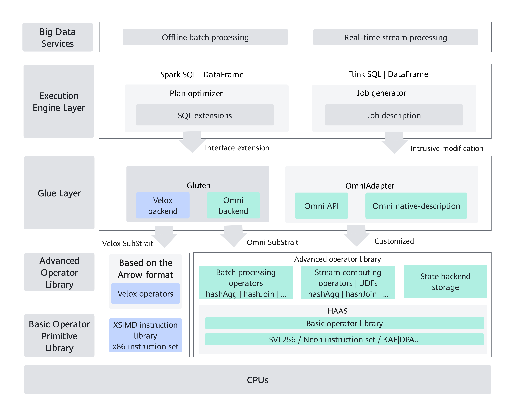

# Latest Updates

-   \[2025-12-30\]: Released OmniOperator 2.0.0, featuring Gluten 1.3 as the adaptation layer for Spark and the new expressions **concat_ws**, **regexp**, **regexp_replace**, **trim**, and **floor** for SparkExtension; updated OmniAdvisor 2.0.0; released OmniStream 1.1.0, which introduces a task-level operator rollback mechanism and the **KeyedCoProcess** operator that supports checkpointing and state restoration; released OmniStateStore 1.1.0, which can connect to the Flink metric framework, implements some common metrics, and provides persistent storage for priority queues as well as separated key-value storage.
-   \[2024-09-30\]: Released the OmniAdvisor 2.0 feature.
-   \[2024-06-30\]: Added support for columnar writes in Parquet format in Spark 3.3.1; introduced compatibility with CentOS 7.9; added the OmniStream Flink Native feature, which uses native code (C/C++) to implement open-source software operators, thereby accelerating Flink execution and improving query performance; added the OmniStateStore feature, which introduces a new state storage mechanism designed to address poor I/O performance for large state workloads, significantly improving Flink's state I/O efficiency.
-   \[2024-03-30\]: Adapted the OmniOperator feature to Spark 3.4.3 and Spark 3.5.2; adapted the OmniMV feature to Spark 3.4.3; introduced the OmniScheduler feature, which leverages the YARN load scheduling algorithm to achieve balanced resource allocation and efficient utilization across cluster nodes in scenarios where Hadoop cluster workloads are unevenly distributed.

# Project Introduction

## Overview

The big data features of OmniRuntime are presented in the form of plugins to improve the performance of data loading, computing, and exchange from end to end.

Data volumes generated from Internet services have been growing much faster than CPUs' computing power. The open-source big data ecosystem is also developing on a fast track. However, diversified computing engines and open-source components make it difficult to improve data processing performance throughout the lifecycle. Different big data engines use their own unique tuning policies and technologies to improve performance and efficiency. Some tuning items may be applied across multiple engines, which may cause resource contention and conflicts, reducing overall computing performance.

OmniRuntime consists of a series of features provided by Kunpeng BoostKit for Big Data in terms of application acceleration. It aims to improve the performance of end-to-end data loading, computing, and exchange through plugins, thereby improving the performance of big data analytics.

[**Table 1**](#Table_1) lists the open-source components and versions to which each subfeature of OmniRuntime has been adapted.

**Table 1** OmniRuntime sub-features and adapted open-source components and versions
<table>
  <colgroup>
    <col style="width: 20%;">
    <col style="width: 60%;">
    <col style="width: 20%;">
  </colgroup>
  <thead>
    <tr>
      <th>Feature</th>
      <th>Description</th>
      <th>Open-Source Component and Version</th>
    </tr>
  </thead>
  <tbody>
    <tr>
      <td>OmniOperator</td>
      <td>OmniOperator implements big data SQL operators in native code (C/C++) to improve query performance. It leverages columnar storage and vectorized execution technologies as well as Kunpeng vectorized instructions, and replaces open-source Java operators with high-performance native operators to improve operator execution efficiency and query engine performance.</td>
      <td>
        <ul>
          <li>Spark 3.1.1</li>
          <li>Spark 3.3.1</li>
          <li>Spark 3.4.3</li>
          <li>Spark 3.5.2</li>
          <li>Hive 3.1.0</li>
          <li>openLooKeng 1.6.1</li>
          <li>Gluten 1.3</li>
        </ul>
      </td>
    </tr>
    <tr>
      <td>OmniMV</td>
      <td>OmniMV uses AI algorithms to recommend the optimal materialized view from historical SQL queries, automatically matches SQL statements with a materialized view in Spark, and replaces part of the SQL statements in an execution plan with the matched materialized view. This feature reduces repeated calculations and increases the query efficiency. You can submit an SQL task to a Spark cluster. The cluster management node distributes the task to multiple compute nodes as subtasks for execution.</td>
      <td>
        <ul>
          <li>Spark 3.1.1</li>
          <li>Spark 3.3.1</li>
          <li>Hive 3.1.0</li>
          <li>ClickHouse 22.3.6.5</li>
        </ul>
      </td>
    </tr>
    <tr>
      <td>OmniScheduler</td>
      <td>OmniScheduler enhances the capacity scheduling algorithm of Hadoop Yarn. It obtains the cluster load information and preferentially schedules low-load nodes based on the physical resource weight calculation and sorting results of node. Consequently, it improves load balancing within the cluster with balanced resource configuration and efficient resource utilization.</td>
      <td>
        <ul>
          <li>Spark 3.1.1</li>
          <li>Spark 3.3.1</li>
          <li>Hive 3.1.0</li>
          <li>Hadoop 3.3.4</li>
        </ul>
      </td>
    </tr>
    <tr>
      <td>OmniShield</td>
      <td>OmniShield is a confidential computing component of the Spark big data engine. It runs in the TEE of the customer's data center to encrypt and decrypt data by executing the computing process in the hardware-based TEE. With OmniShield, data security in the REE is also safeguarded. In confidential computing scenarios, OmniShield provides data source encryption and decryption capabilities for DataFrame and SparkSQL applications, and also end-to-end security protection for Spark applications based on the Arm confidential computing trusted execution environment (TEE) kit.</td>
      <td>
        <ul>
          <li>Spark 3.3.1</li>
          <li>Hive 3.1.0</li>
        </ul>
      </td>
    </tr>
    <tr>
      <td>OmniStream</td>
      <td>OmniStream uses native code (C/C++) to implement Flink SQL operators to improve query performance. The Flink engine is reconstructed natively for enhanced performance.</td>
      <td>
        <ul>
          <li>Flink 1.16.3</li>
        </ul>
      </td>
    </tr>
    <tr>
      <td>OmniStateStore</td>
      <td>OmniStateStore acts as the Flink backend plugin to accelerate state storage and improve the overall Flink performance.</td>
      <td>
        <ul>
          <li>Flink 1.16.1</li>
          <li>Flink 1.16.3</li>
          <li>Flink 1.17.1</li>
        </ul>
      </td>
    </tr>
  </tbody>
</table>

## Architecture

The following figure shows the OmniRuntime architecture.

# Feature Description

**Table 2** Feature description

<table><thead align="left"><tr id="row23424320348"><th class="cellrowborder" valign="top" width="12.861286128612862%" id="mcps1.2.4.1.1">
Category

</th>
<th class="cellrowborder" valign="top" width="16.89168916891689%" id="mcps1.2.4.1.2">
Feature

</th>
<th class="cellrowborder" valign="top" width="70.24702470247026%" id="mcps1.2.4.1.3">
Description

</th>
</tr>
</thead>
<tbody><tr id="row8343133223416"><td class="cellrowborder" rowspan="3" valign="top" width="12.861286128612862%" headers="mcps1.2.4.1.1 ">
<strong id="b1589315383368">Offline batch processing</strong>

</td>
<td class="cellrowborder" valign="top" width="16.89168916891689%" headers="mcps1.2.4.1.2 ">
<a href="https://gitcode.com/openeuler/OmniOperator" target="_blank" rel="noopener noreferrer">OmniOperator</a>

</td>
<td class="cellrowborder" valign="top" width="70.24702470247026%" headers="mcps1.2.4.1.3 ">
Uses C++ and vectorized instructions to implement batch processing operators, uses the columnar in-memory data format OmniVec for in-memory computing, thereby making full use of vectorized instructions to accelerate SQL computing performance.

</td>
</tr>
<tr id="row1834363210344"><td class="cellrowborder" valign="top" headers="mcps1.2.4.1.1 ">
<a href="https://gitcode.com/openeuler/Gluten" target="_blank" rel="noopener noreferrer">Gluten</a>

</td>
<td class="cellrowborder" valign="top" headers="mcps1.2.4.1.2 ">
Introduces a high-performance native backend for the Spark engine based on Gluten.

</td>
</tr>
<tr id="row4343232173416"><td class="cellrowborder" valign="top" headers="mcps1.2.4.1.1 ">
<a href="https://gitcode.com/openeuler/OmniAdaptor" target="_blank" rel="noopener noreferrer">OmniAdaptor</a>

</td>
<td class="cellrowborder" valign="top" headers="mcps1.2.4.1.2 ">
A bridge component between Spark and OmniOperator, and between Flink and OmniStream, serving as a glue layer that enables runtime coordination between the two.

</td>
</tr>
<tr id="row834363210349"><td class="cellrowborder" rowspan="2" valign="top" width="12.861286128612862%" headers="mcps1.2.4.1.1 ">
<strong id="b9434185012367">Real-time stream processing online acceleration feature</strong>

</td>
<td class="cellrowborder" valign="top" width="16.89168916891689%" headers="mcps1.2.4.1.2 ">
<a href="https://gitcode.com/openeuler/OmniStream" target="_blank" rel="noopener noreferrer">OmniStream</a> 

</td>
<td class="cellrowborder" valign="top" width="70.24702470247026%" headers="mcps1.2.4.1.3 ">
Uses C++ and vectorized instructions to implement streaming operators, uses the columnar in-memory data format OmniVec for in-memory computing, thereby making full use of vectorized instructions to accelerate SQL computing performance.

</td>
</tr>
<tr id="row4343163212348"><td class="cellrowborder" valign="top" headers="mcps1.2.4.1.1 ">
<a href="https://gitcode.com/openeuler/OmniStateStore" target="_blank" rel="noopener noreferrer">OmniStateStore</a> 

</td>
<td class="cellrowborder" valign="top" headers="mcps1.2.4.1.2 ">
In internet-scale search and recommendation big data scenarios, extremely large states ranging from tens to dozens of terabytes can be generated. Flink's native backend state storage uses RocksDB; however, when handling such ultra-large states, it faces bottlenecks such as poor read/write performance and high CPU overhead, which in turn affect Flink job processing latency. BoostStateStore is a high-performance state storage acceleration component that builds a state access acceleration layer using memory and NVMe SSDs. It also optimizes the LSM-tree compaction process to reduce the impact of CPU jitter on Flink job execution.

</td>
</tr>
</tbody>
</table>

# About the Community

This part provides the introduction and guidance to the public modules, such as the community governance architecture, SIG operations regulations, contribution, email subscription, and social media contact information.

# Contributions, Suggestions, and Discussions

We welcome your contributions to the community. If you have any questions/suggestions or want to provide feedback on feature requirements and bug reports, you can [submit issues](https://gitcode.com/boostkit/community/blob/master/docs/contributor/issue-submit.md). For details, see the [contribution guideline](https://gitcode.com/boostkit/community/blob/master/docs/contributor/contributing.md). You are also welcome to share insights in the [Discussions](https://gitcode.com/boostkit/community/discussions). Thank you for your support.

# LICENSE

This project is licensed under Apache License 2.0. For details, see [LICENSE](LICENSE).

The documents of this project are licensed under CC-BY 4.0. For details, see [LICENSE](LICENSE).
